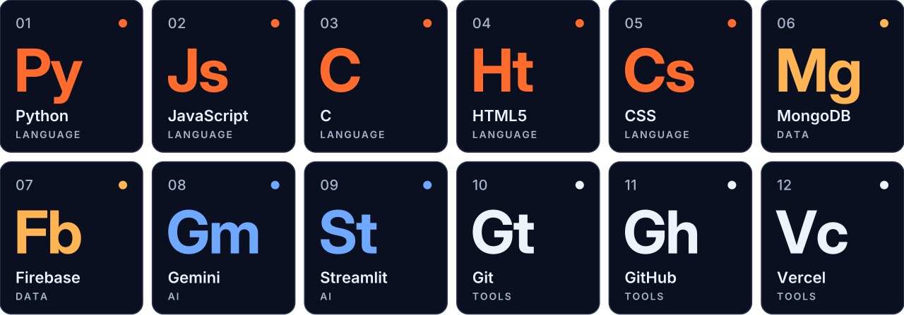
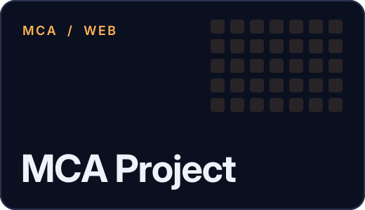

  

I'm an MCA student specialising in AI & Data Science at Graphic Era University, Dehradun. I enjoy turning AI ideas into web apps people can actually use, and I'm currently sharpening my full-stack and problem-solving skills. Always happy to connect and build something useful together.

  

<table>
  <tr>
    <td width="42%"></td>
    <td>AI-powered crop advisory and farmer assistance platform with Gemini-based plant health analysis.  <a href="https://github.com/Mrr-Sandy/ai-crop-advisory-platform">Code</a> · <a href="https://ai-crop-advisory-platform.vercel.app">Live demo</a></td>
  </tr>
  <tr>
    <td width="42%"></td>
    <td><a href="https://github.com/Mrr-Sandy/MCA-Project">Code</a></td>
  </tr>
  <tr>
    <td width="42%"></td>
    <td>Responsive website built with HTML, CSS and JavaScript.  <a href="https://github.com/Mrr-Sandy/Tripper-Project">Code</a></td>
  </tr>
</table>

  
  

  

  
  

